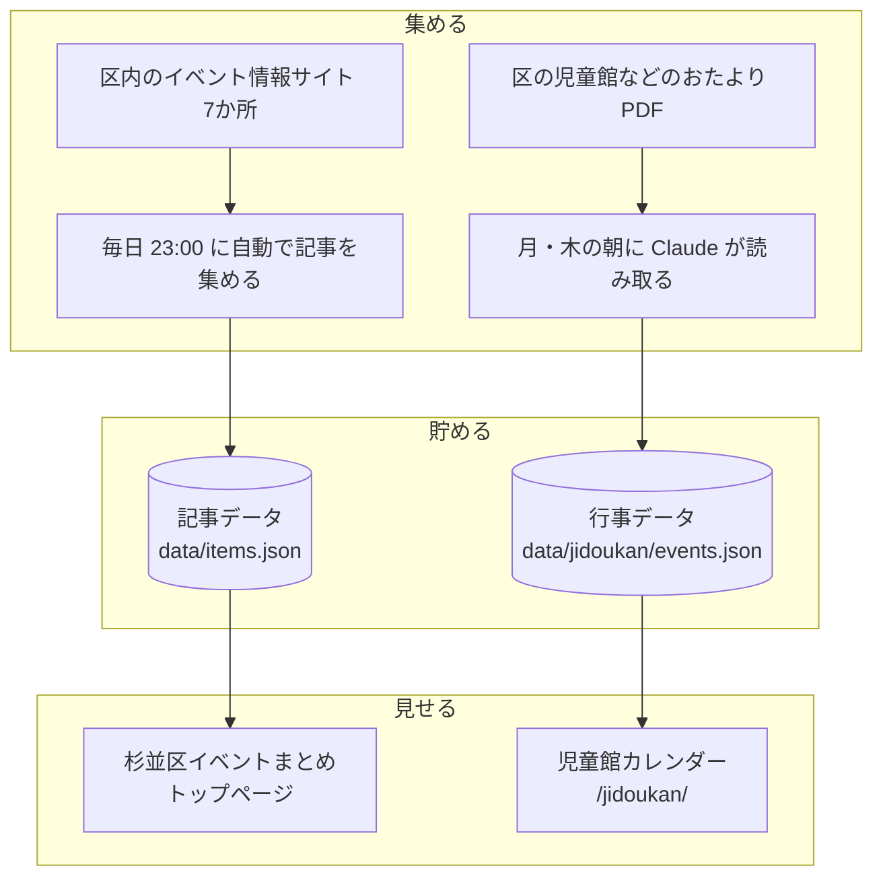
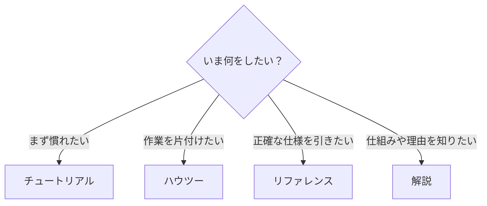

# 開発者ドキュメント

杉並区イベントまとめ（`gghatano/suginami-matome`）の開発者向けドキュメントです。初めてこのリポジトリを触る人でも、迷わずに作業を始められることを目指しています。人と Claude の両方が読みます。

- ブラウザで読む：https://gghatano.github.io/suginami-matome/docs/
- 5分で要点だけ：[スライド](https://gghatano.github.io/suginami-matome/docs/slides.html)（原本は [`slides.md`](slides.md)）
- 元の Markdown：リポジトリの `docs/` フォルダ（こちらが正本。HTML 版は同じ Markdown を整形して見せているだけ）

## このリポジトリでできていること

サーバーで動くプログラムはありません。データ（JSON ファイル）を定期的に作り直し、それをブラウザのページが読み込んで表示しているだけです。

## 読み方

ドキュメントは、**読む人がそのとき何をしたいか**で4種類に分けています（Diátaxis という整理の型）。

### はじめての人へ（この順に読む）

1. [用語集](glossary.md)：ブランチ、PR、マージなど、この先に出てくる言葉
2. [全体の構成](explanation/architecture.md)：何がどこにあって、データがどう流れるか
3. [はじめての変更](tutorial/first-change.md)：手元で動かし、小さな変更を本番に出すまでを一通り体験する

### チュートリアル（手を動かして覚える）

| ドキュメント | やること |
|---|---|
| [はじめての変更](tutorial/first-change.md) | 手元で画面を表示 → 文言を1つ変える → PR → develop で確認 → 本番へ |

### ハウツー（よくある作業の手順書）

| やりたいこと | ドキュメント |
|---|---|
| 児童館カレンダーに施設を増やす | [児童館を増やす](howto/add-jidoukan.md) |
| まとめサイトに情報源を増やす | [取得元を増やす](howto/add-event-source.md) |
| 画面の見た目や動きを変える | [画面を変える](howto/change-screen.md) |
| develop の変更を本番に出す | [本番に出す](howto/release.md) |
| 児童館カレンダーの定期更新を確かめる・直す | [定期更新を見る・直す](howto/weekly-update.md) |
| ドキュメントを書く・直す | [ドキュメントを書く](howto/write-docs.md) |

### リファレンス（正確な仕様の一覧）

| ドキュメント | 内容 |
|---|---|
| [ファイルとフォルダ](reference/files.md) | どのファイルが何をしているか |
| [コマンド](reference/commands.md) | よく使うコマンドと、その意味 |
| [記事データ（items.json）](reference/data-items.md) | まとめサイトのデータ形式 |
| [児童館のデータ](reference/data-jidoukan.md) | sources.json・キャッシュ・events.json の形式 |
| [児童館カレンダーの URL と保存値](reference/url-params.md) | URL パラメータ、ブラウザに保存するもの |
| [環境と自動処理](reference/environments.md) | 本番・プレビュー・Pages、定期実行、権限 |

### 解説（仕組みと理由）

| ドキュメント | 内容 |
|---|---|
| [全体の構成](explanation/architecture.md) | 2つのサイト、データの流れ、ホスティング、開発の流れ |
| [児童館カレンダーのしくみ](explanation/jidoukan-pipeline.md) | おたよりを読む流れと、なぜそうしているか |
| [画面づくりの原則](explanation/ui-principles.md) | ずれない、最初の画面、色、幅、文言 |
| [これまでの判断と失敗](explanation/history.md) | 過去に決めたこと・起きた失敗と、その理由 |

### 持ち出し用（ほかのリポジトリで使う）

| ドキュメント | 内容 |
|---|---|
| [方針定義書](kit/policy.md) | このドキュメントの作り方を、どのリポジトリでも使える形にまとめた決まり |
| [指示書](kit/instructions.md) | 方針定義書と一緒に Claude Code に渡す依頼文。`{{ }}` を埋めて使う |

[用語集](glossary.md) はどこからでも引けます。

## 困ったら

- 言葉が分からない → [用語集](glossary.md)
- 何かが動かない → [環境と自動処理](reference/environments.md) の「困ったとき」と、[定期更新を見る・直す](howto/weekly-update.md)
- ドキュメントとコードが食い違っている → コードが正しい。気づいたら [ドキュメントを書く](howto/write-docs.md) に沿って直す

最初の仕様書 [`spec.md`](../spec.md) には古い記述（ホスティング、更新時刻など）が残っています。食い違ったときは、このドキュメントとコードを正とします。
