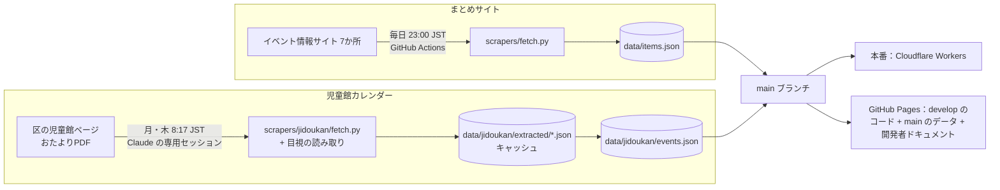

# 全体の構成

## 2つのサイト

このリポジトリは、静的なページを2つ配信しています。サーバー側の処理はなく、HTML と JSON を配っているだけです。

| サイト | パス | 中身 | データ |
|---|---|---|---|
| 杉並区イベントまとめ | `/`（`index.html`） | 区内のイベント情報サイトを毎日クロールした記事の一覧とカレンダー | `data/items.json` |
| 児童館カレンダー | `/jidoukan/`（`jidoukan/index.html`） | 児童館などのおたより（PDF）から読み取った行事と申込の受付開始日 | `data/jidoukan/events.json` |

どちらも、ページの JavaScript が JSON を `fetch` して描画します。ビルドの工程はありません。

## データの流れ

- まとめサイトのデータは GitHub Actions（`.github/workflows/fetch.yml`）が毎日 `main` に直接コミットします。
- 児童館カレンダーのデータは、スケジュールしたタスクから起動される Claude の専用セッションが `main` に直接 push します（詳しくは [operations.md](operations.md)）。
- コードの変更は、ブランチ → PR → `develop` → `main` の順で入ります。

## ディレクトリ

| パス | 役割 |
|---|---|
| `index.html` | まとめサイトの画面（HTML・CSS・JS を1ファイルに同梱） |
| `jidoukan/index.html` | 児童館カレンダーの画面（同上） |
| `assets/icons/` | まとめサイトで使う取得元のアイコン |
| `data/items.json` | まとめサイトの記事データ（最大500件、URL で重複排除） |
| `data/jidoukan/sources.json` | 児童館カレンダーの対象施設の一覧 |
| `data/jidoukan/extracted/<施設>/<PDF名>.json` | おたより1号ごとの読み取り結果（キャッシュ） |
| `data/jidoukan/events.json` | 画面が読む児童館カレンダーのデータ（キャッシュから生成） |
| `scrapers/` | まとめサイトのスクレイパー（`fetch.py` が入口） |
| `scrapers/jidoukan/` | 児童館カレンダーの取得・登録・生成（`fetch.py`, `register.py`, `extract.py`, `SESSION.md`） |
| `.github/workflows/` | 定期実行とデプロイ（`fetch.yml`, `jidoukan.yml`, `pages.yml`） |
| `docs/` | このドキュメント（Markdown が正本、`index.html` は閲覧用） |
| `CLAUDE.md` | Claude Code 向けの入口 |
| `wrangler.jsonc` | Cloudflare Workers の設定（リポジトリ直下をそのまま静的配信） |
| `.assetsignore` | Cloudflare に配信しないファイル（`docs/` など） |

## ホスティング

| 環境 | 配信元 | URL | 用途 |
|---|---|---|---|
| 本番 | Cloudflare Workers（`main`） | Cloudflare の本番 URL | 利用者が見るサイト |
| プレビュー | Cloudflare Workers（PR のブランチ） | PR に bot がコメントする Branch Preview URL | PR ごとの見た目の確認 |
| 開発用 | GitHub Pages（`develop` のコード + `main` のデータ） | https://gghatano.github.io/suginami-matome/ | `develop` に入った変更の確認、開発者ドキュメント（`/docs/`） |

開発者ドキュメント（`docs/`）は `.assetsignore` で Cloudflare から外しているので、本番とプレビューには出ません。見られるのは GitHub Pages だけです。
