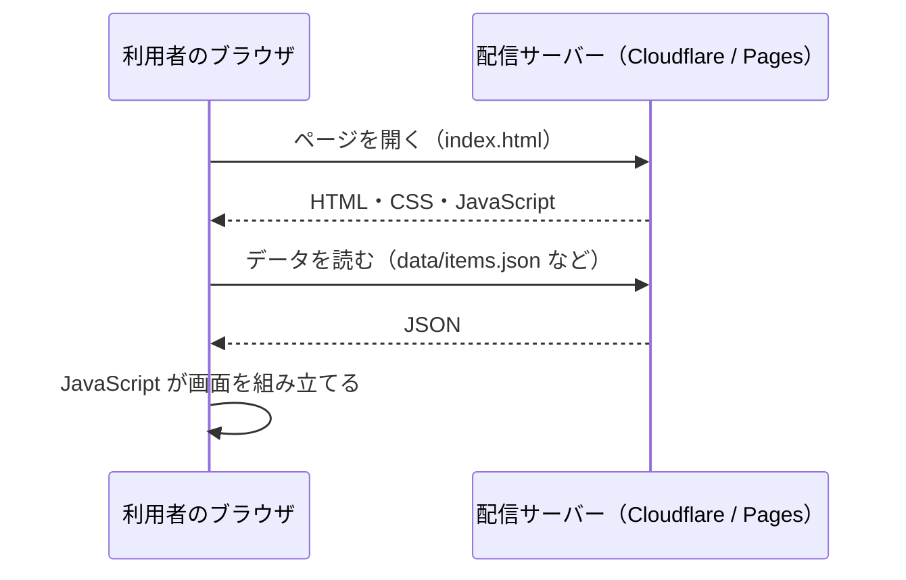
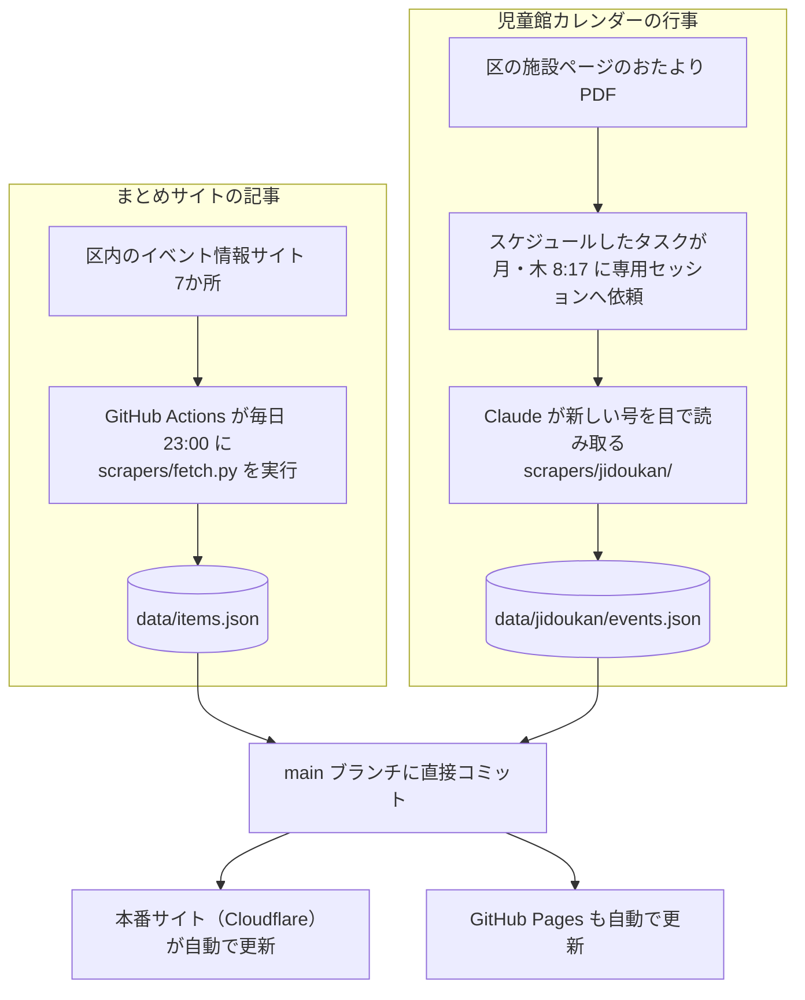
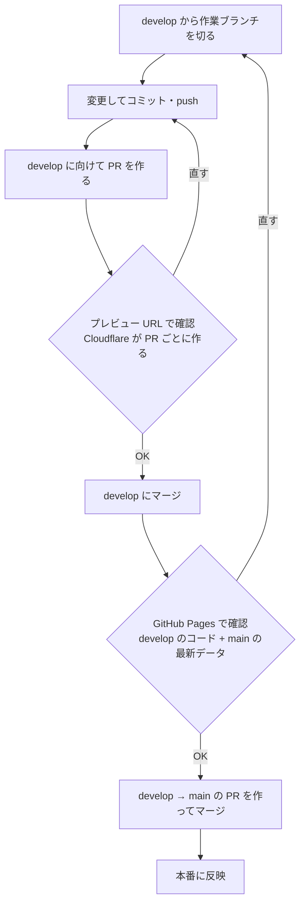
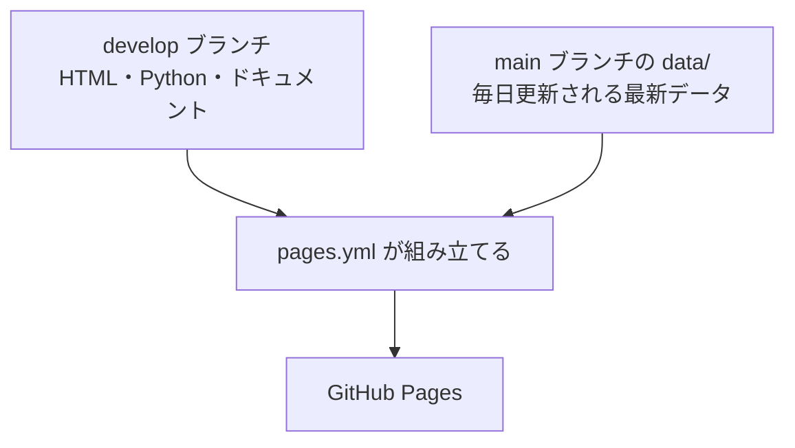
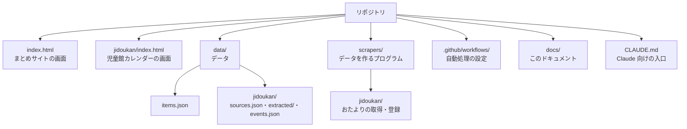

# 全体の構成

この文書では、このリポジトリが「何を」「どうやって」動かしているかを、図を中心に説明します。細かい形式は [リファレンス](../README.md#リファレンス正確な仕様の一覧) にあります。

## 2つのサイト

| サイト | アドレス | 見せているもの | 読み込むデータ |
|---|---|---|---|
| 杉並区イベントまとめ | `/`（`index.html`） | 区内のイベント情報サイトから毎日集めた記事の一覧とカレンダー | `data/items.json` |
| 児童館カレンダー | `/jidoukan/`（`jidoukan/index.html`） | 児童館などのおたより（PDF）から読み取った行事と、申込の受付開始日 | `data/jidoukan/events.json` |

どちらも「静的サイト」です。サーバー側でプログラムは動いていません。ページを開くと、ブラウザの中の JavaScript がデータ（JSON）を読み込み、画面を組み立てます。

## データができるまで

データは2つの別々の仕組みで作られ、どちらも最後は `main` ブランチに入ります。

児童館カレンダーの読み取りの詳しい流れは [児童館カレンダーのしくみ](jidoukan-pipeline.md) にあります。

## コードの変更が本番に届くまで

データとは違い、プログラム（HTML・Python など）の変更は、必ず確認を2回挟んでから本番に出ます。

手順は [はじめての変更](../tutorial/first-change.md) と [本番に出す](../howto/release.md) で、実際に手を動かしながら説明しています。

## 3つの公開先

| 公開先 | 中身 | 何に使うか |
|---|---|---|
| 本番（Cloudflare Workers） | `main` | 利用者が見るサイト |
| プレビュー（Cloudflare Workers） | PR のブランチ | PR ごとの見た目の確認 |
| 開発用（GitHub Pages） | `develop` のコード + `main` の最新データ + 開発者ドキュメント | develop に入った変更の確認、このドキュメントを読む |

Pages が「`develop` のコード」に「`main` のデータ」を重ねているのは、データの定期更新が `main` にしか入らないためです。こうしておくと、`develop` のデータが古くても、Pages では最新のデータで確認できます。

開発者ドキュメントと `CLAUDE.md` は、`.assetsignore` で Cloudflare に出さないようにしています。本番とプレビューには出ず、Pages でだけ読めます。

## フォルダの全体像

ファイルごとの説明は [ファイルとフォルダ](../reference/files.md) にあります。
