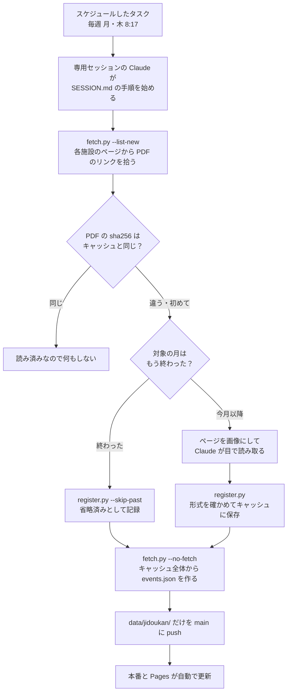
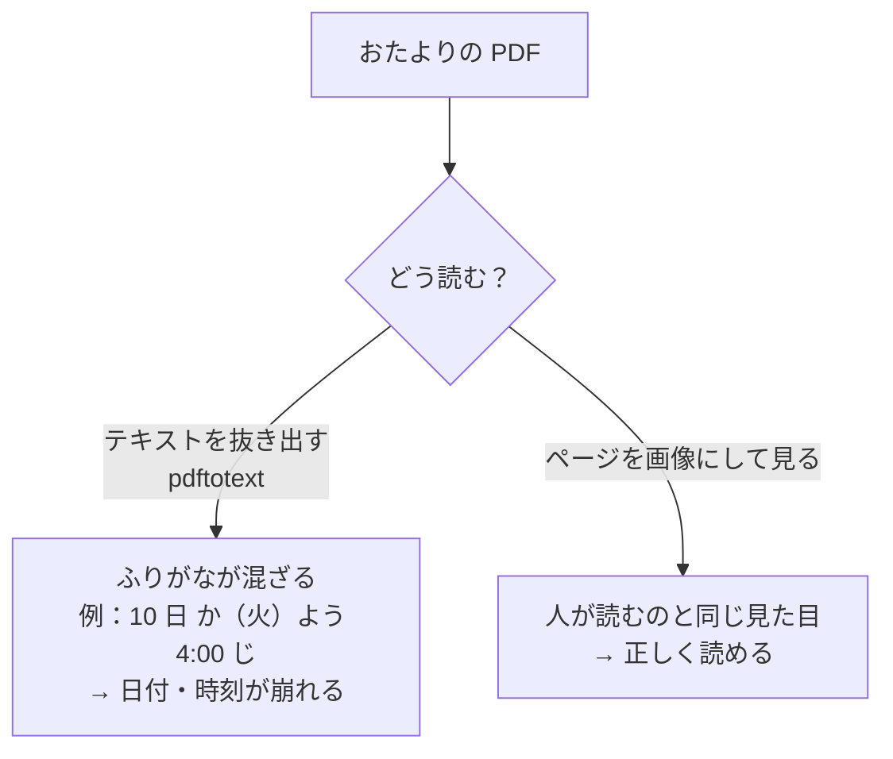
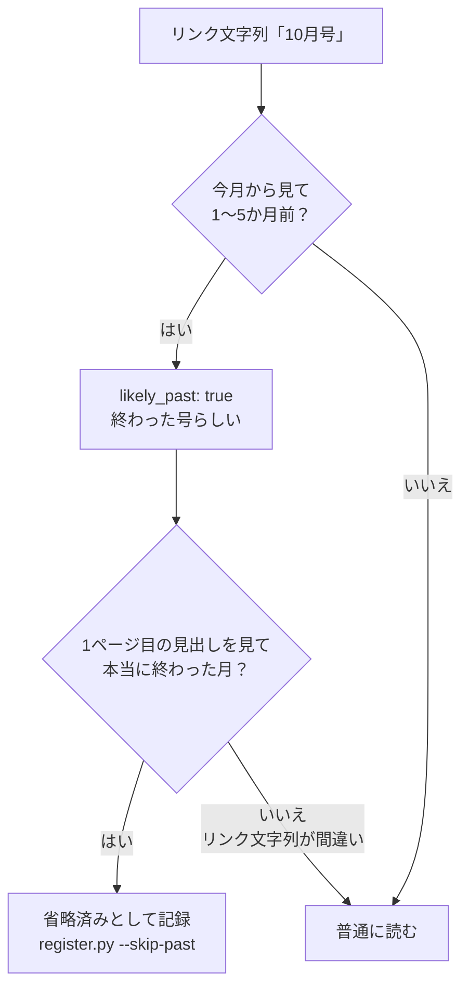
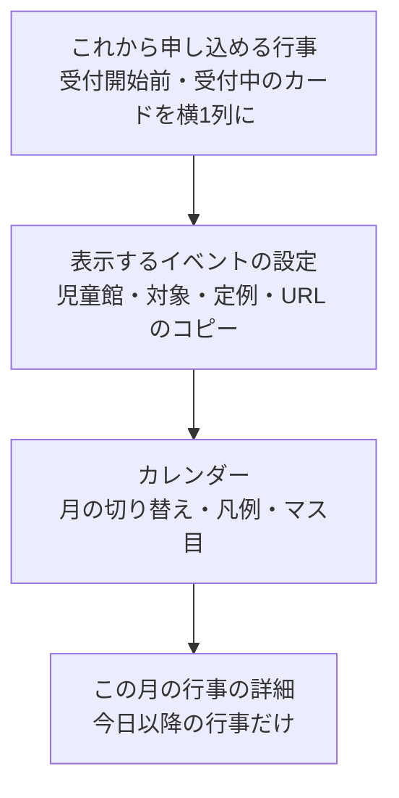

# 児童館カレンダーのしくみ

児童館カレンダー（`/jidoukan/`）は、区の児童館などが毎月出す「おたより」（PDF）から、行事の日程と**申込の受付開始日**を読み取り、1つのカレンダーにまとめています。いちばんの目的は、申込の受付開始日を見逃さないことです。

この文書では、おたよりが画面に出るまでの流れと、なぜそうしているかを説明します。施設を増やす手順は [児童館を増やす](../howto/add-jidoukan.md)、データの細かい形式は [児童館のデータ](../reference/data-jidoukan.md) にあります。

## 対象の施設

| `key` | 施設 | 画面の短い名前 | 読む PDF（リンク文字列） |
|---|---|---|---|
| `honan` | 方南児童館 | 方南 | 「おたより」 |
| `horinouchi_higashi` | 堀ノ内東児童館 | 堀ノ内東 | 「おたより」 |
| `horinouchi_minami` | ゆうキッズほりみなみ（堀ノ内南学童クラブ） | ほりみなみ | 「おたより」 |
| `plaza_izumi` | 子ども・子育てプラザ和泉 | プラザ和泉 | 「ニュース」 |

一覧の正本は `data/jidoukan/sources.json` です。

## おたよりが画面に出るまで

定期更新の手順書は [`scrapers/jidoukan/SESSION.md`](../../scrapers/jidoukan/SESSION.md) です。専用セッションは毎回これを読み直すので、手順を変えたいときは `SESSION.md` を直して `main` に入れれば、次の回から反映されます。

## なぜ PDF を「目で」読むのか

おたよりの PDF には、漢字の上に小さなふりがな（ルビ）が付いています。PDF の中では、このふりがなが本文と同じ「文字」として入っています。そのため、PDF からテキストを抜き出すと、ふりがなが日付や時刻の間に割り込んで、内容が崩れます。

段組みも施設ごとに自由で、決まった場所に日付がある、ということもありません。そこで、ページを画像にして、Claude が人と同じように目で読んでいます。

読み取りの方法は2通りあります。どちらも、読むときのルールと結果の形は `scrapers/jidoukan/extract.py` の `INSTRUCTIONS` と `SCHEMA` で決まっています。ルールを変えるときは、ここだけを直します。

| 方法 | 使う場面 | 必要なもの |
|---|---|---|
| 専用セッションの Claude が画像を見て読む | **通常の定期更新**（月・木） | なし（プランの利用枠で動く） |
| Claude API に PDF を渡して読む | 手動実行のワークフロー `jidoukan.yml` | リポジトリのシークレット `ANTHROPIC_API_KEY` |

## なぜキャッシュを持つのか

区のページには、今月号と前の月の号が並んでいます。毎回すべてを読み直すと時間も利用枠も無駄になるので、一度読んだ号は `data/jidoukan/extracted/<施設>/<PDF名>.json` に保存し、PDF の sha256（中身から計算する指紋）が同じなら読み直しません。

キャッシュには次のような利点もあります。

- 読み取りに誤りがあれば、このファイルを手で直せる。PDF が差し替わらない限り、その修正が残る
- 区が PDF を差し替えると sha256 が変わるので、自動で読み直される
- どの号を、いつ、どの方法で読んだかが残る（`method`、`extracted_at`）

## なぜ「終わった月の号」は読まないのか

区のページに残っている前の月の号は、カレンダーにはもう役に立ちません。読まずに放っておくと毎回「未読」として出てきてしまうので、読まずに**省略済み**として記録します。

リンク文字列は中身とずれることがあるので、最後の判断は必ず表紙の見出しで行います。

## 読み取った結果を確かめるしくみ

`events.json` を作るとき（`fetch.py` の `normalize`）に、次を確かめて警告を出します。

| 確かめること | 見つかったとき |
|---|---|
| 日付の形式（`YYYY-MM-DD`） | その日を落とす |
| 開催日がおたよりの対象月の外 | 残す（翌月の予告なら正常） |
| 開催日が休館日と重なる | その日を落とす |
| 時刻が 9 時より前 | 午後とみなして 12 時間足す（おたよりの「4:00」は 16:00） |
| 申込制なのに受付開始日がない | 警告だけ出す |

## 画面のつくり

上から、いちばん大事な「申し込める行事」→ 表示の設定 → カレンダー → 詳細の順に並べています。並び順の理由や、ずれない作りについては [画面づくりの原則](ui-principles.md) にあります。

URL パラメータやブラウザに保存するものは [児童館カレンダーの URL と保存値](../reference/url-params.md) を見てください。

## 既知の課題

- 未読が 0件のとき、「新しい号が出ていない」のか「区のページの作りが変わって PDF を見つけられない」のかを見分けられない（[Issue #47](https://github.com/gghatano/suginami-matome/issues/47)）。いまは定期更新の指示で、各館の PDF リンク数を毎回報告させて補っている
- 区のページは月末（25日ごろ）にまとめて更新される傾向がある。号が出てから定期更新で反映されるまで、最大で3〜4日かかる
