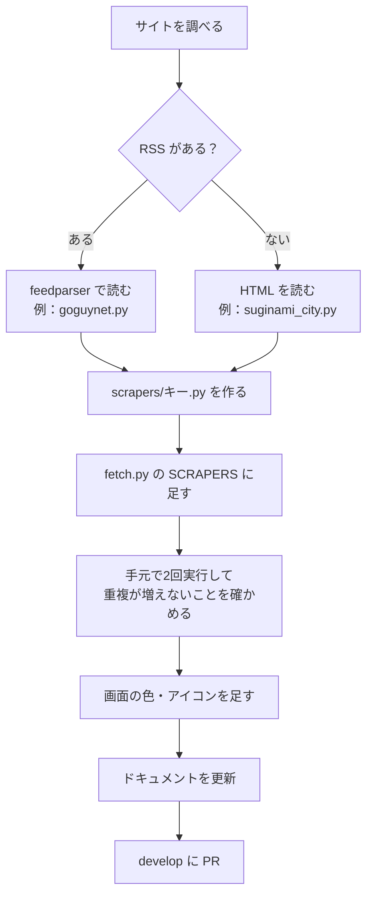

# 取得元を増やす（まとめサイト）

杉並区イベントまとめに、新しい情報源（イベント情報サイト）を追加する手順です。

## 流れ



## 1. サイトを調べる

- RSS（新着記事の配信）があれば、それを使うのがいちばん安定する
- なければ HTML から読む。記事の一覧のどの要素にタイトル・リンク・日付があるかを確かめる
- robots.txt と利用規約を確かめ、取得してよいサイトかを確かめる

## 2. スクレイパーを書く

`scrapers/<key>.py` に、`scrapers/base.py` の `BaseScraper` を継承したクラスを書きます。

```python
from base import BaseScraper, Item

class ExampleScraper(BaseScraper):
    def fetch(self) -> list[Item]:
        try:
            ...  # サイトを読んで Item のリストを作る
            return items
        except Exception:
            return []  # 失敗しても例外を投げず、空のリストを返す
```

決まりごとです。

- 失敗したときは例外を投げず、空のリストを返す（1つのサイトの失敗で、ほかのサイトの取得を止めないため）
- `Item` の `source_key` は英小文字。記事の `id` は URL から自動で作られる
- HTML の取得は `scrapers/httputil.py` の `get_soup` を使う

## 3. `fetch.py` に足す

`scrapers/fetch.py` の `SCRAPERS` の配列に、作ったクラスを足します。

## 4. 手元で確かめる

```bash
pip install -r requirements.txt
python scrapers/fetch.py   # 1回目：新しい記事が追加される
python scrapers/fetch.py   # 2回目：追加が 0件になる（重複しない）
```

確かめたら、`data/items.json` の変更はコミットしないでください（データは定期更新が `main` に入れます）。

```bash
git checkout -- data/items.json
```

## 5. 画面

- `index.html` の `SOURCE_COLORS` に、取得元の色を足す
- アイコンがあれば `assets/icons/` に置く

## 6. ドキュメント

- [記事データ（items.json）](../reference/data-items.md) の「取得元」の表に1行足す
- README のクロール対象サイトの表に1行足す
