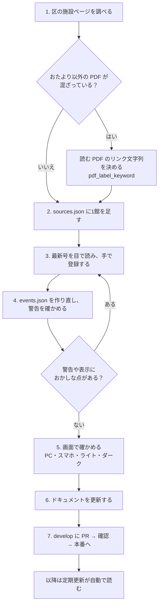
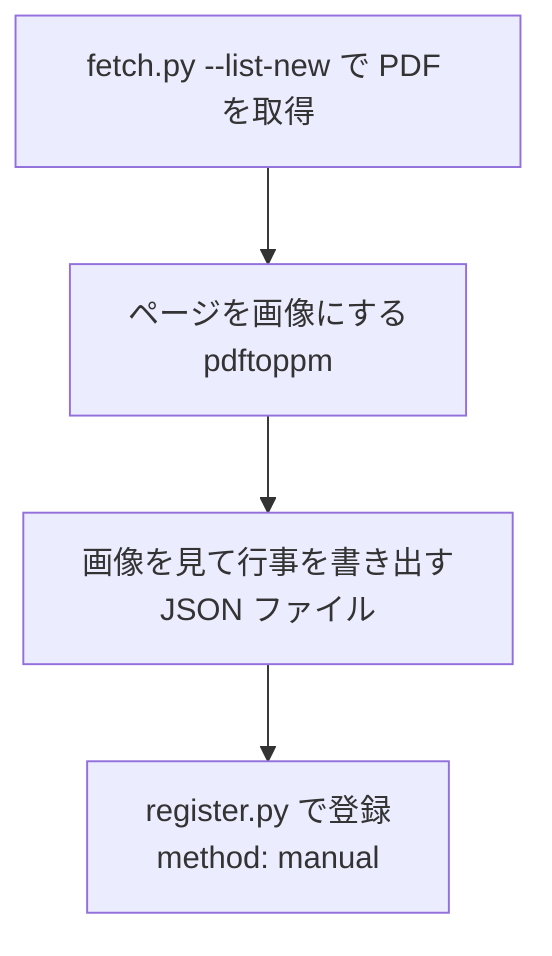

# 児童館を増やす

児童館カレンダーに、新しい施設（児童館、子ども・子育てプラザ、学童クラブのゆうキッズなど）を追加する手順です。

- **所要時間の目安**：1館あたり 30分〜1時間（最初の号を目で読んで登録するのに、いちばん時間がかかる）
- **前提**：[はじめての変更](../tutorial/first-change.md) を一度やって、手元で画面を表示できること
- **しくみの説明**：[児童館カレンダーのしくみ](../explanation/jidoukan-pipeline.md)

## 全体の流れ



最初の号だけは、人（または Claude）が目で読んで登録します。施設ごとに PDF の作りや載せ方の癖が違い、そのまま自動に任せると取りこぼしや誤読が起きやすいためです。最初の号で問題がないことを確かめてから、定期更新に任せます。

## 1. 区の施設ページを調べる

施設のページ（例：`https://www.city.suginami.tokyo.jp/s076/3517.html`）を開き、次の点を確かめます。

| 確かめること | なぜ | これまでの例 |
|---|---|---|
| おたよりの PDF のリンク文字列 | どの PDF を読むかを、リンク文字列で決めるため | 「方南児童館のおたより11月号」「子ども・子育てプラザ和泉のニュース11月号」 |
| おたより以外の PDF があるか | チラシやお知らせを読み込むと、行事がおかしくなるため | 堀ノ内東：「中高生向けチラシ」／プラザ和泉：「利用拡大のお知らせ」 |
| 同じ行事が載った別の PDF があるか | 両方読むと行事が二重に出るため | プラザ和泉：「プレママ・プレパパのイベント情報」はニュースの再掲 |
| 施設の住所と電話番号 | 申込カードと画面の下部に出すため | 「お問い合わせ」欄に載っている |

ファイル名ではなく、**リンク文字列**を見てください。ファイル名と号がずれていることがあります（堀ノ内東の11月号のファイル名は `...2610.pdf` でした）。

## 2. `sources.json` に1館を足す

`data/jidoukan/sources.json` の配列の最後に追加します。

```json
{
  "key": "plaza_izumi",
  "name": "子ども・子育てプラザ和泉",
  "short": "プラザ和泉",
  "page_url": "https://www.city.suginami.tokyo.jp/s086/3531.html",
  "address": "杉並区和泉2-36-14",
  "tel": "03-3328-6550",
  "pdf_label_keyword": ["ニュース"]
}
```

| 項目 | 決め方 |
|---|---|
| `key` | 英小文字とアンダースコア。あとから変えない（キャッシュのフォルダ名や URL パラメータに使う） |
| `name` | 画面に出す正式な名前 |
| `short` | カレンダーのチップや凡例に出す短い名前（4〜5文字まで） |
| `pdf_label_keyword` | 省略すると「おたより」。違う言葉なら書く。複数あれば配列で書き、どれか1つを含めば読む |

**並び順が施設の色になります。** 1館目が緑、2館目が紫、…と6色を順に使います。7館目から色が重なるので、そのときは [画面づくりの原則](../explanation/ui-principles.md) の「色」を見てください。

## 3. 最新号を目で読み、手で登録する



```bash
pip install requests beautifulsoup4 lxml
python scrapers/jidoukan/fetch.py --list-new .jidoukan_pdfs
```

出力された一覧の中から、新しい施設の項目を見つけます。`pdf_path`（ダウンロードした PDF）、`url`、`sha256` を控えておきます。終わった月の号（`likely_past: true`）が混ざっていれば、それは手順 3' で省略として登録します。

PDF をページの画像にして読みます。

```bash
pdftoppm -r 120 -png .jidoukan_pdfs/<施設>__<ファイル名>.pdf page
# 細かい日付は -r 220 で拡大して確かめる
```

読み取った内容を JSON ファイルに書きます。形式と読み取りのルールは `scrapers/jidoukan/extract.py` の `SCHEMA` と `INSTRUCTIONS` に従います（[児童館のデータ](../reference/data-jidoukan.md) にも説明があります）。

読むときの注意点です。

- 時刻は 24 時間表記にする（おたよりの「4:00」は 16:00）
- 休館日は `closed_days` に入れる
- 翌月の予告（「12月の予告」など）も、その日付のまま入れる。翌月の行事の申込が今月始まることがあるため
- 原本の中で日付が食い違っていたら、曜日やほかの行事との整合から正しい方を選び、行事の `notes` に判断を1行残す
- 毎日・毎週の定例のプログラムは `regular: true`

登録します。

```bash
python scrapers/jidoukan/register.py <key> <url> <sha256> <読み取った.json> --label "<リンク文字列>" --method manual
```

### 3'. 終わった月の号は省略として登録する

ページに前の月の号も載っていれば、読まずに省略として登録します。登録しないと、毎回「未読」として出てきます。

```bash
python scrapers/jidoukan/register.py <key> <url> <sha256> --skip-past 2026-10 --label "<リンク文字列>"
```

## 4. events.json を作り直し、警告を確かめる

```bash
python scrapers/jidoukan/fetch.py --no-fetch
```

警告の見方です。

| 警告 | 意味 | どうするか |
|---|---|---|
| 開催日が対象月の外です（翌月の予告なら正常） | 翌月の行事が入っている | 予告なら問題なし。そうでなければ日付を直す |
| 開催日が休館日と重なっています | 休館日の行事は落とされる | どちらかの読み間違いを直す |
| 申込制ですが受付開始日が読み取れていません | 申込カードに受付日が出ない | 原本を見直す |
| 日付が不正 | `YYYY-MM-DD` になっていない | 書き方を直す |

## 5. 画面で確かめる

```bash
python -m http.server 8000
# http://localhost:8000/jidoukan/?center=<key> を開く
```

| 見るところ | 確かめること |
|---|---|
| 表示するイベントの設定 | 新しい施設のボタンが、決めた色で出る |
| これから申し込める行事 | 申込制の行事が出る。カードの中身が枠からはみ出していない |
| カレンダー | 行事が正しい日に出る。休館日が灰色になる |
| 全館表示 | ほかの館と並べても、レイアウトがずれない |
| スマホ・ダーク | 横スクロールが出ない。文字が読める |

## 6. ドキュメントを更新する

- [児童館カレンダーのしくみ](../explanation/jidoukan-pipeline.md) の「対象の施設」の表に1行足す
- その施設だけの事情があれば、[これまでの判断と失敗](../explanation/history.md) と、下の「これまでの実例」に足す

## 7. develop に PR を出す

[はじめての変更](../tutorial/first-change.md) と同じ流れです。PR の説明には、読み取った号、行事の数、申込制の行事、気づいた点（原本の食い違いなど）を書きます。

マージして本番に出たあとは、定期更新（月・木）が次の号から自動で読みます。最初の定期更新の結果は [定期更新を見る・直す](weekly-update.md) で確かめます。

## チェックリスト

- [ ] 施設ページの PDF のリンク文字列を確かめた。おたより以外の PDF の扱いを決めた
- [ ] `sources.json` に足した（`key`、`name`、`short`、`page_url`、`address`、`tel`、必要なら `pdf_label_keyword`）
- [ ] 最新号を目で読んで登録した（`method: manual`）。前の月の号は省略として登録した
- [ ] `fetch.py --no-fetch` の警告を確かめた
- [ ] 画面を PC・スマホ・ライト・ダークで確かめた
- [ ] `fetch.py --list-new` を実行して、新しい施設の未読が 0件になった
- [ ] ドキュメントを更新した

## これまでの実例

施設を足すたびに、その施設ならではの事情が見つかっています。次に足す施設でも何か出てくると考えておくと安全です。

| 施設 | 見つかった事情 | 対応 |
|---|---|---|
| 方南児童館 | 漢字のふりがなが本文に混ざり、テキスト抽出では日付が崩れる | PDF を画像にして目で読む |
| 堀ノ内東児童館 | 11月号のファイル名が `...2610.pdf` | 年月はファイル名でなく中身で決める |
| 堀ノ内東児童館 | 同じページに中高生向けチラシの PDF | リンク文字列に「おたより」を含むものだけ読む |
| 堀ノ内東児童館 | 本文は「12日」、注記は「27日（木）」と食い違う | 曜日の整合で 12日を採り、`notes` に残す |
| ゆうキッズほりみなみ | 児童館ではなく学童クラブ。11月号に12月の行事と、その申込開始（11/16）が載る | 翌月の予告も読む。予告だけの月にもカレンダーで移動できるようにした |
| 子ども・子育てプラザ和泉 | リンク文字列が「おたより」ではなく「ニュース」 | `pdf_label_keyword` を複数指定できるようにした |
| 子ども・子育てプラザ和泉 | プレママ向けの PDF がニュースの再掲 | ニュースだけ読む |
| 子ども・子育てプラザ和泉 | 対象・定員の説明が長い、同じ日に2回ある | 申込カードの高さを固定し、各項目の行数を決めた |
