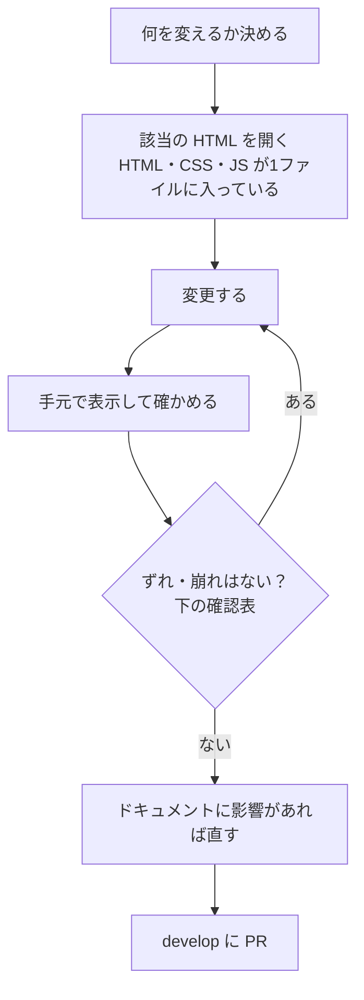

# 画面を変える

まとめサイト（`index.html`）や児童館カレンダー（`jidoukan/index.html`）の見た目や動きを変える手順です。守るべき原則は [画面づくりの原則](../explanation/ui-principles.md) にあります。

## 流れ



## どこを触るか

両方のページとも、HTML・CSS・JavaScript を1つのファイルにまとめています。ライブラリやビルドの工程はありません。

| 変えたいもの | 探す場所 |
|---|---|
| 色 | ファイル冒頭の `:root{...}` の変数（ライトの値）と、`prefers-color-scheme: dark` / `[data-theme="dark"]` の中（ダークの値）。両方を直す |
| レイアウト・余白 | `<style>` の中のクラス |
| 並び順・見出し | `<body>` の中の HTML |
| 表示の中身（児童館カレンダー） | `renderApply`（申込カード）、`renderCal`（カレンダー）、`renderDetails`（詳細）、`chip`（チップ） |
| 表示の中身（まとめサイト） | `render`（一覧）、`renderCalendar`、`renderHero`、`renderUpcoming` |

## 確認のしかた

### 手元で見る

```bash
python -m http.server 8000
```

ブラウザの開発者ツールで、スマホの幅に切り替えて見ます。

### 確認表

| 項目 | 確かめること |
|---|---|
| PC（1280×800） | 開いたときにカレンダーの1週目まで見える（児童館カレンダー） |
| スマホ（iPhone 相当、幅 390px） | 横スクロールが出ない。文字が潰れていない |
| ライト／ダーク | どちらでも文字が読める。色が変数から来ている |
| 件数の多い・少ない・0件 | 下の要素の位置がずれない |
| 表示する／しない | 切り替えても、下の要素の位置がずれない |
| Windows 相当のスクロールバー | 横スクロールの有無で高さが変わらない |

### Playwright で測る

見た目だけでなく、要素の位置を数値で比べると、わずかなずれにも気づけます。

```js
// 例：件数を変えて、下の要素の位置が変わらないかを測る
const { chromium } = require("playwright");
(async () => {
  const b = await chromium.launch({ ignoreDefaultArgs: ["--hide-scrollbars"] }); // Windows 相当のスクロールバー
  const p = await b.newPage({ viewport: { width: 1280, height: 800 } });
  for (const q of ["", "?center=honan&target=baby", "?center=horinouchi_higashi&target=kids"]) {
    await p.goto("http://localhost:8000/jidoukan/" + q);
    await p.waitForTimeout(1000);
    console.log(q, await p.evaluate(() => document.querySelector(".picker").getBoundingClientRect().top));
  }
  await b.close();
})();
```

どのパターンでも同じ数値なら、ずれていません。

## よくある落とし穴

| 落とし穴 | 対処 |
|---|---|
| 0件のときに欄が縮む | 高さを固定し、0件でも同じ高さの枠に「0件」と出す |
| 長い文字が折り返して高さが変わる | 行数を決めて `…` で切る。全文は `title` 属性で出す |
| ダークで色が読めない | 色を直接書かず、変数を使う |
| スマホで表が潰れる | 表に最低限の幅を持たせ、表の中だけを横スクロールさせる |

## ドキュメントも直す

画面の構成や URL パラメータを変えたら、同じ PR で次を直します。

- [児童館カレンダーのしくみ](../explanation/jidoukan-pipeline.md) の「画面のつくり」
- [児童館カレンダーの URL と保存値](../reference/url-params.md)
- 新しい原則ができたら [画面づくりの原則](../explanation/ui-principles.md)
