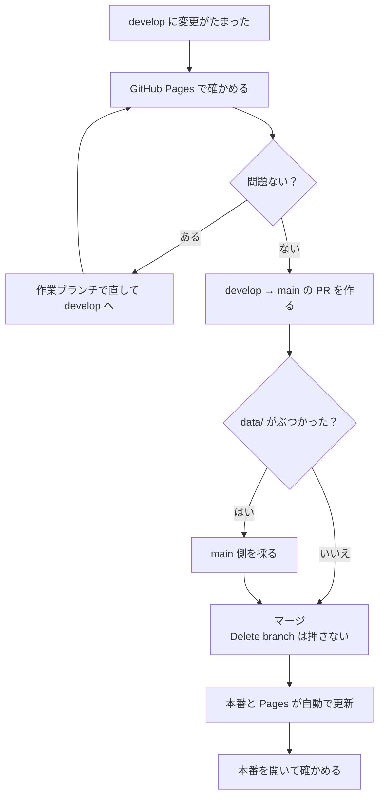

# 本番に出す（develop → main）

`develop` にたまった変更を、本番（`main`）に出す手順です。

## 流れ

## 手順

1. GitHub Pages（https://gghatano.github.io/suginami-matome/ ）で、`develop` の変更を確かめる
2. GitHub で「New pull request」を開き、**base を `main`、compare を `develop`** にする
3. タイトルは「リリース：〜」とし、説明に含まれる変更（元の PR の番号）を並べる
4. マージする。**「Delete branch」は押さない**
5. 数分後、本番のサイトを開いて確かめる

## 気をつけること

### 「Delete branch」を押さない

この PR では `develop` が head（取り込まれる側）です。マージ画面の「Delete branch」を押すと、**`develop` が消えます**。以前、`develop` が消えて GitHub Pages の更新が2か月止まったことがあります。

防ぐには、GitHub の Settings → Rules（Rulesets）で `develop` に「削除を禁止する（Restrict deletions）」ルールを付けておきます。

### data/ がぶつかったら main 側を採る

データ（`data/items.json`、`data/jidoukan/`）は、定期更新が `main` に直接入れています。`develop` 側の `data/` は古いことがあるので、ぶつかったら `main` 側を採ります。

### workflow を変えたら早めに main へ

`.github/workflows/` の変更は、早めに `main` に出してください。データの定期更新のあとに動く Pages の更新は、`main` にあるワークフローの設定で動くためです。`develop` だけを変えても、毎日の更新で古い設定に戻ってしまいます。
