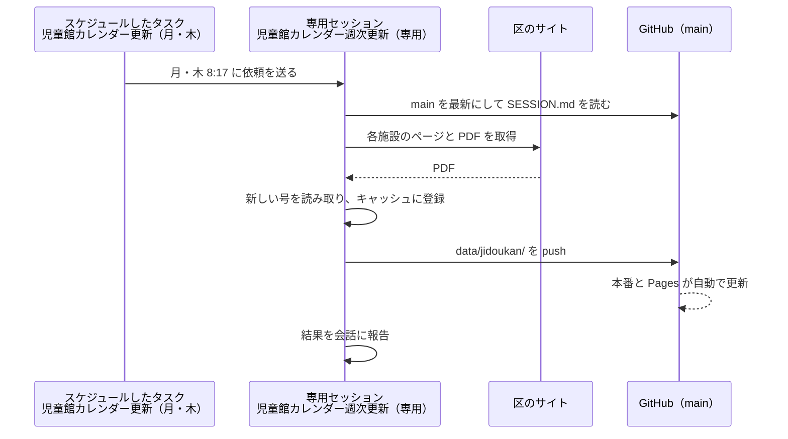
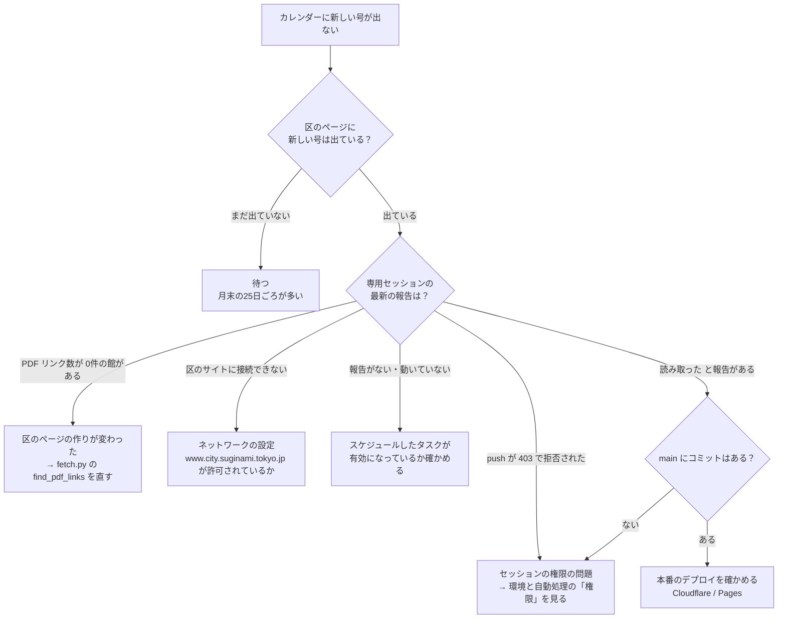

# 定期更新を見る・直す

児童館カレンダーの定期更新（毎週 月・木 8:17）がうまく動いているかを確かめ、止まっていたら直す手順です。しくみは [児童館カレンダーのしくみ](../explanation/jidoukan-pipeline.md) にあります。

## 登場するもの

## 結果を見る

結果は、claude.ai/code の「児童館カレンダー週次更新（専用）」セッションの会話に残ります（スマホへの通知はありません）。毎回、次の内容を報告する決まりです。

- 読み取った号・省略した号
- 申込制の行事の数
- 判断に迷った箇所
- 各施設のページで見つかった PDF のリンク数

GitHub の `main` のコミット履歴に `chore: update jidoukan calendar ...` があれば、更新が入っています。新しい号がない回は、コミットはありません。

## うまく動いていないとき

### 同じ号が毎回「未読」に出る

読み取った結果をキャッシュに登録していないか、終わった月の号を省略として登録していません。`register.py`（または `--skip-past`）で登録します。手順は [児童館を増やす](add-jidoukan.md) の 3 と 3' と同じです。

### 読み取りが間違っていた

`data/jidoukan/extracted/<施設>/<PDF名>.json` を直してから、`python scrapers/jidoukan/fetch.py --no-fetch` で `events.json` を作り直し、`main` に入れます。PDF が差し替わらない限り、その修正が残ります。

### 手順そのものを変えたい

`scrapers/jidoukan/SESSION.md` を直して、`main` に入れます。専用セッションは毎回これを読み直すので、次の回から反映されます。
