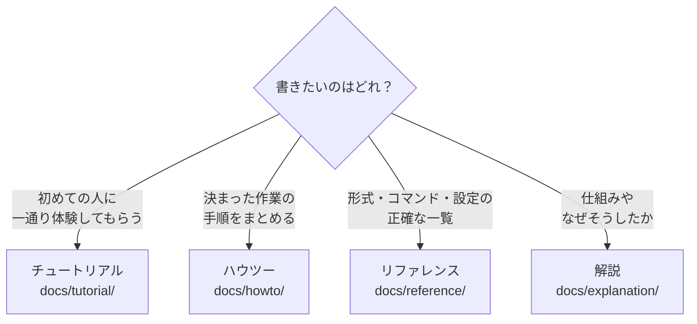
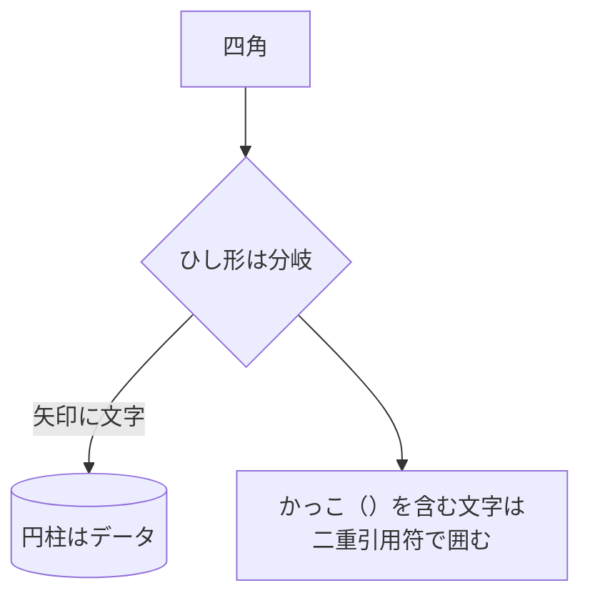

# ドキュメントを書く

このドキュメント（`docs/`）を書く・直すときの決まりごとです。

## 原本は Markdown

**編集するのは `docs/*.md` だけです。** 人が読む HTML は、どれも Markdown を読み込んで表示しているだけで、本文を持っていません。

| HTML | 読み込む Markdown | 用途 |
|---|---|---|
| `docs/index.html` | `DOCS` 配列に並べた各 `.md` | 閲覧ページ（目次つき） |
| `docs/slides.html` | `docs/slides.md` | 最初の5分で読むスライド |

- HTML に本文を書かない。直したい文は、元の `.md` で直す
- Claude は `.md` を直接読む。人は HTML で読む。中身は同じ

## 4つの種類に分ける

ドキュメントは「読む人がそのとき何をしたいか」で4種類に分けています。Diátaxis（ディアタキシス）という、技術文書を整理するときによく使われる型です。



| 種類 | 読む人の状態 | 書き方 | 書かないこと |
|---|---|---|---|
| チュートリアル | 初めてで、まず慣れたい | 1本道の手順。必ず成功するように。所要時間とゴールを先に書く | 選択肢や例外の説明 |
| ハウツー | やりたい作業が決まっている | 手順・確認表・チェックリスト。実例を添える | 仕組みの長い説明（解説へのリンクにする） |
| リファレンス | 正確な値を引きたい | 表で網羅する。コードと一致させる | 手順や理由 |
| 解説 | 仕組みや理由を知りたい | 図と「なぜ」を中心に | 手順 |

1つのファイルに種類を混ぜないようにします。混ざりそうになったら、片方を別のファイルに分けてリンクします。

## 書き方

- **初めての人を想定する。** 専門用語は [用語集](../glossary.md) に足し、初出でリンクする
- **図を使う。** 流れは Mermaid の縦向きのフローチャート（`flowchart TD`）で描く。登場人物のやりとりは `sequenceDiagram`
- **「なぜ」を残す。** 過去の失敗や判断は [これまでの判断と失敗](../explanation/history.md) に足す
- **表と箇条書きで拾い読みできるようにする。** 1段落は短く
- **パスはリポジトリからの相対で書く**（例：`scrapers/jidoukan/fetch.py`）
- **コードと食い違わせない。** 仕様を変えたら、同じ PR でドキュメントも直す

### Mermaid の書き方の注意



- 改行は `<br>`
- 文字に `(` `)` `[` `]` を含むときは、`"..."` で囲む
- 横長になる図は `TD`（上から下）にする。スマホでも読みやすい

## ファイルを足したとき

1. 該当する種類のフォルダに置く（`docs/howto/xxx.md` など）
2. [`docs/README.md`](../README.md) の表に1行足す
3. [`docs/index.html`](../index.html) の `DOCS` 配列に足す（目次に出る）
4. 手元の `http://localhost:8000/docs/` で表示を確かめる

## スライドを直す

`docs/slides.md` を編集します。`---` だけの行でスライドを区切ります（スライドの中では `---` を区切り線として使えません）。

- 1枚に載せるのは見出し1つと、箇条書きか表を1つ。詳しい話はリンク先のドキュメントに任せる
- PC では1枚ずつ（← → キー、クリック）、スマホでは縦に並べて表示する
- 手順や仕様を変えてスライドの内容と食い違ったら、同じ PR で直す

## 閲覧ページのしくみ

`docs/index.html` は、Markdown をブラウザで整形して表示しているだけです。編集するのはいつも Markdown です。

- 目次は `DOCS` 配列から作る
- docs の中の `.md` へのリンクは、閲覧ページの中で開く
- リポジトリのほかのファイルへのリンクは、GitHub のファイル表示を開く
- ` ```mermaid ` は図にする
- 整形用のライブラリを読み込めないときは、Markdown の原文をそのまま出す
