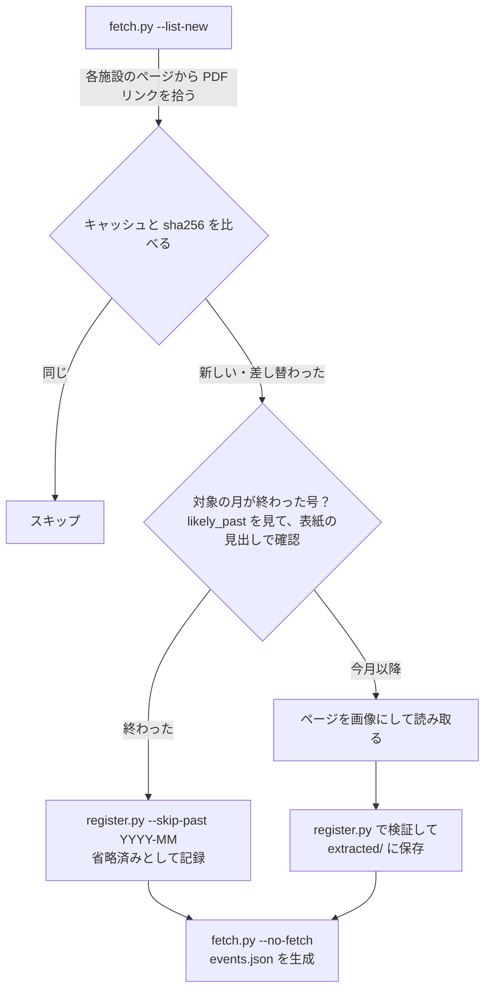

# 児童館カレンダー（`/jidoukan/`）

区の児童館などが毎月出す「おたより」（PDF）から、行事の日程と**申込の受付開始日**を読み取って、1つのカレンダーにまとめたページです。受付開始日を見逃さないことを、いちばんの目的にしています。

## 対象の施設（`data/jidoukan/sources.json`）

| `key` | 施設 | `short`（画面の短い名前） | 読むPDF（リンク文字列で判定） |
|---|---|---|---|
| `honan` | 方南児童館 | 方南 | 「おたより」 |
| `horinouchi_higashi` | 堀ノ内東児童館 | 堀ノ内東 | 「おたより」 |
| `horinouchi_minami` | ゆうキッズほりみなみ（堀ノ内南学童クラブ） | ほりみなみ | 「おたより」 |
| `plaza_izumi` | 子ども・子育てプラザ和泉 | プラザ和泉 | 「ニュース」 |

各項目のフィールドは `key`、`name`、`short`、`page_url`、`address`、`tel`、`pdf_label_keyword`（省略時は「おたより」。文字列か、どれかを含めばよい文字列の配列）です。並び順が、そのまま画面の施設の色の順になります（6色を順に使う）。

## なぜ PDF を「目で」読むのか

おたよりの PDF は、漢字の上のふりがな（ルビ）が本文の文字として混ざっています。そのため `pdftotext` などでテキストを抜き出すと、日付と時刻が崩れます。段組みも施設ごとに自由です。そこで、PDF をページの画像にして、Claude が目で読み取っています。

読み取りの方法は2通りあります。

| 方法 | 使う場面 | 必要なもの |
|---|---|---|
| Claude のセッションが画像を見て読む | **通常の定期更新**（月・木） | なし（プランの利用枠で動く） |
| Claude API に PDF を渡して読む（`scrapers/jidoukan/extract.py`） | 手動実行のワークフロー `jidoukan.yml` | リポジトリのシークレット `ANTHROPIC_API_KEY` |

どちらも、読み取りのルールと返す JSON の形は `extract.py` の `INSTRUCTIONS` と `SCHEMA` に従います。ルールを変えるときは、ここだけを直します。

## 処理の流れ



手順の全文は [`scrapers/jidoukan/SESSION.md`](../scrapers/jidoukan/SESSION.md) にあります。定期更新のセッションはこれに従って動きます。

### コマンド

```bash
pip install requests beautifulsoup4 lxml
python scrapers/jidoukan/fetch.py --list-new .jidoukan_pdfs     # 未読の号をダウンロードして一覧（JSON）
python scrapers/jidoukan/register.py <key> <url> <sha256> data.json --label "<リンク文字列>"   # 読み取り結果を登録
python scrapers/jidoukan/register.py <key> <url> <sha256> --skip-past 2026-10 --label "..."   # 終わった号を省略として登録
python scrapers/jidoukan/fetch.py --no-fetch                     # キャッシュから events.json だけ作り直す
ANTHROPIC_API_KEY=... python scrapers/jidoukan/fetch.py          # API で取得・読み取り・出力（手動実行用）
```

### キャッシュ（`data/jidoukan/extracted/<key>/<PDF名>.json`）

| フィールド | 内容 |
|---|---|
| `pdf_url` / `pdf_label` | 元の PDF とリンク文字列 |
| `sha256` | PDF の中身のハッシュ。これが変わらない限り読み直さない |
| `method` | `manual`（人が見て登録）、`claude-scheduled-session`（定期更新のセッション）、`claude-opus-5-5`（API）、`skipped-past`（省略） |
| `skipped` | 省略した号だけに付く。画面には出さない |
| `data` | `year`、`month`、`events`、`closed_days` |

読み取りに誤りがあれば、このファイルを手で直してかまいません。PDF が差し替わらない限り、その修正が残ります。

### 検証（`fetch.py` の `normalize`）

`events.json` を作るときに、次を確かめて警告を出します。

- 日付の形式（`YYYY-MM-DD`）
- 開催日がおたよりの対象月の外（翌月の予告なら正常なので残す）
- 開催日が休館日と重なる（落とす）
- 時刻が 9 時より前なら午後とみなして12時間足す（おたよりの「4:00」は 16:00）
- 申込制なのに受付開始日がない

### `events.json`

| キー | 内容 |
|---|---|
| `centers` | `sources.json` の写し |
| `months` | 号ごとの年月・PDF・休館日（省略した号は入らない） |
| `events` | 行事。`id`、`center`、`title`、`audience`（`kids`／`baby`／`all`）、`regular`（毎日・毎週のもの）、`sessions`（日付と時刻）、`requires_application`、`application_start`／`application_end`、`application_method` など |
| `warnings` | 検証の警告 |

## 画面（`jidoukan/index.html`）

上から次の順に並びます。

1. **これから申し込める行事**：受付開始前・受付中の行事のカード。横1列で、はみ出す分は横にスクロールする
2. **表示するイベントの設定**：児童館（複数選択）、対象（すべて／小学生以上／乳幼児親子）、定例（毎日・毎週のプログラムを出すか）、この設定の URL をコピー
3. **カレンダー**：月の切り替え、凡例、マス目。スマホ（760px 以下）では「一覧／カレンダー」を切り替えられる
4. **この月の行事の詳細**：今日以降の行事だけを出す

ほかに次の挙動があります。

- 終わった週（その週の土曜が今日より前）のマスは薄く表示する
- 申込の受付開始日は、オレンジのチップでカレンダーに出す。押すとその行事の詳細へ移る（別の月ならその月へ移る）
- 予告だけの月（おたよりの号がまだ出ていない翌月など）にも移動できる

### URL パラメータ

パラメータが1つでもあれば、URL だけで表示を決めます（ブラウザに保存した選択は使わない）。画面で選択を変えると URL も書き換わります。

| パラメータ | 値 | 省略時 |
|---|---|---|
| `center` | 施設の `key`。複数はカンマ区切り | 全館 |
| `target` | `kids`／`baby` | すべて |
| `regular` | `1` で毎日・毎週のプログラムも出す | 出さない |
| `month` | `YYYY-MM` | 今月（なければ直近の号の月） |
| `view` | `month` でスマホもマス目表示 | 一覧 |

例：方南の乳幼児向けだけ → `/jidoukan/?center=honan&target=baby`

### ブラウザに保存するもの（`localStorage`）

| キー | 内容 |
|---|---|
| `jdk-off` | 外した施設の一覧（外したものだけを覚えるので、増えた施設は最初から表示される） |
| `jdk-filt` | 対象 |
| `jdk-reg` | 毎日・毎週のプログラムを出すか |
| `jdk-view` | スマホの表示（一覧／カレンダー） |
| `theme` | ダークモード（まとめサイトと共有） |

## 施設を足すとき

施設を足すたびに、その施設だけの事情が見つかってきました。最初の1号は人が目で読んで登録し、問題がないことを確かめてから定期更新に任せます。

1. 区の施設ページを開き、PDF のリンク文字列を確かめる。おたより以外の PDF（チラシ、お知らせ、別冊）が混ざっていないか見る。混ざっていれば `pdf_label_keyword` で絞る
2. `sources.json` に1館を足す（`short` も決める）
3. 最新号の PDF を画像にして読み、`register.py` で `method: "manual"` として登録する
4. `fetch.py --no-fetch` で警告を確かめ、画面で表示を確かめる（PC とスマホ、施設の色、申込カード）
5. この表とドキュメントを更新する

これまでに見つかった事情は次のとおりです。

| 施設 | 事情 | 対応 |
|---|---|---|
| 堀ノ内東 | 11月号のファイル名が `...2610.pdf`（ファイル名と号がずれる） | 年月はファイル名でなく中身で決める |
| 堀ノ内東 | 同じページに「中高生向けチラシ」の PDF がある | リンク文字列で「おたより」を含むものだけ読む |
| 堀ノ内東 | 本文と注記で日付が食い違う（12日と「27日（木）」） | 曜日やほかの行事との整合で正しい方を選び、`notes` に残す |
| ほりみなみ | 翌月（12月）の行事と、その申込開始（11/16）が11月号に載る | 翌月の予告も含めて読む。予告だけの月にも移動できるようにした |
| プラザ和泉 | 「プレママ・プレパパのイベント情報」がニュースの行事の再掲 | 「ニュース」だけを読む（重複を避ける） |
| プラザ和泉 | 対象や定員の説明が長い、同じ日に2回ある | 申込カードの高さを固定し、各項目の行数を決めた |

## 既知の課題

- 未読が0件のとき、「新着がない」のか「ページの作りが変わって PDF を見つけられない」のかを見分けられない（[Issue #47](https://github.com/gghatano/suginami-matome/issues/47)）。今は定期更新タスクの指示文で、各館の PDF リンク数を報告させて補っている
- 区のページは施設ごとにまとめて月末（25日ごろ）に更新される傾向がある。号が出てから定期更新で反映されるまで、最大で3〜4日かかる
