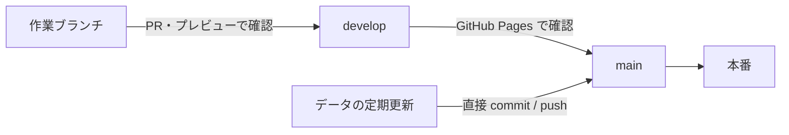

# 運用

## 環境

| 環境 | ホスティング | ブランチ | 更新のきっかけ | 見るもの |
|---|---|---|---|---|
| 本番 | Cloudflare Workers | `main` | `main` への push（データの定期更新を含む） | 利用者向けのサイト |
| プレビュー | Cloudflare Workers | PR のブランチ | PR への push（PR に bot が Branch Preview URL をコメント） | PR の見た目 |
| 開発用 | GitHub Pages | `develop` のコード + `main` のデータ | `develop`・`main` への push、データ更新ワークフローの完了、手動 | `develop` に入った変更、開発者ドキュメント（`/docs/`） |

- GitHub Pages：https://gghatano.github.io/suginami-matome/ （ドキュメントは `/docs/`）
- Pages のワークフローは `.github/workflows/pages.yml`。`develop` のコードに、`main` の `data/` を重ねて配信します。データは `main` にしか入らないので、`develop` 側のデータが古くても Pages は最新のデータで動きます。`develop` が無いときは `main` をそのまま配信します。
- データの定期更新は GitHub Actions 自身の push で `main` を更新します。この push では他のワークフローが起動しないので、Pages は「ワークフローの完了」（`workflow_run`）をきっかけにも更新します。
- `docs/` と `CLAUDE.md` は `.assetsignore` で Cloudflare から外しています。本番とプレビューには出ません。

## 開発の流れ

1. `develop` から作業ブランチを切り、PR を `develop` に向けて出す。PR のプレビュー URL で見た目を確かめる
2. `develop` にマージすると GitHub Pages が更新される。ほかの変更と合わせた状態をそこで確かめる
3. 問題なければ `develop` → `main` の PR を出してマージする。本番に反映される
4. データ（`data/items.json`、`data/jidoukan/`）は定期更新が `main` に直接入れる。`develop` には入らないが、Pages は `main` のデータを重ねるので困らない。`develop` → `main` の PR で `data/` がぶつかったら `main` 側を採る

`develop` は消さないでください。以前、`develop` が消えて Pages の更新が2か月止まったことがあります。

- `develop` → `main` の PR では `develop` が「head ブランチ」になります。マージ画面の「Delete branch」を押したり、GitHub の「Automatically delete head branches」を有効にしていたりすると、`develop` が消えてしまいます。
- 防ぐには、Settings → Rules（Rulesets）で `develop` に「削除を禁止する（Restrict deletions）」ルールを付けておきます。

## 定期実行

| 何を | いつ | どこで | 結果の置き場所 |
|---|---|---|---|
| まとめサイトの記事 | 毎日 23:00 JST | GitHub Actions（`fetch.yml`） | `data/items.json` を `main` に commit |
| 児童館のおたより | 毎週月・木 8:17 JST | スケジュールしたタスク「児童館カレンダー更新（月・木）」→ Claude の専用セッション「児童館カレンダー週次更新（専用）」 | `data/jidoukan/` を `main` に push |
| 児童館のおたより（API 版） | 手動のみ | GitHub Actions（`jidoukan.yml`） | 同上（`ANTHROPIC_API_KEY` が必要） |

### 児童館カレンダーの定期更新のしくみ

- スケジュールしたタスクは、毎回同じ専用セッションに依頼を送ります。セッションは `main` の `scrapers/jidoukan/SESSION.md` を読み直して、その手順で進めます。手順を変えたいときは `SESSION.md` を直して `main` に入れれば、次回から反映されます。
- 専用セッションは、このリポジトリを指定して作ったので push の権限があります。最初は「毎回まっさらなセッションを作る」タスクにしていましたが、リポジトリが紐づかず push が 403 で拒否され続けたため、今の形に変えました。
- 結果は専用セッションの会話に残ります（スマホへの通知はありません）。
- 新着がない回はコミットしません。そのときも各館の PDF リンク数を報告させています（[Issue #47](https://github.com/gghatano/suginami-matome/issues/47) が片付くまでの暫定対応）。

## 権限とできないこと

| 操作 | Claude のセッションから | 備考 |
|---|---|---|
| ブランチへの push、PR の作成・マージ | できる | マージは人が頼んだときだけ |
| `main` への直接 push | できる | データの定期更新だけで使う |
| リモートブランチの削除 | **できない**（プロキシが 403 で拒否） | GitHub の画面（Branches）から消す |
| github.io・Cloudflare のページを開いて確かめる | できない（ネットワークの許可外） | 人がブラウザで確かめる |
| 区のサイト（`www.city.suginami.tokyo.jp`）の取得 | できる | 環境のネットワーク設定で許可済み |

## 困ったとき

| 症状 | よくある原因 | 対処 |
|---|---|---|
| GitHub Pages が古いまま | `develop` が無い、Pages のデプロイが失敗している | Actions の「Deploy to GitHub Pages」を見る。`github-pages` 環境の Deployment branches に `main` と `develop` が許可されているか確かめる |
| 児童館カレンダーが更新されない | 定期更新の push が拒否された、区のページの構成が変わった | 専用セッションの会話の報告を見る |
| 同じおたよりが毎回「未読」に出る | 読み取り結果をキャッシュに登録していない | `register.py`（または `--skip-past`）で登録する |
| PR をマージしたのに一部の変更が入っていない | マージした後に同じブランチへ push した | 最新の `main` から作り直して、別の PR にする |
