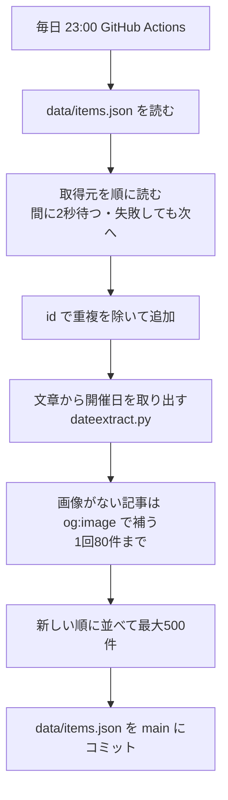

# 記事データ（items.json）

杉並区イベントまとめ（トップページ）のデータです。全体の仕様の原本は [`spec.md`](../../spec.md) にあります（ホスティングと更新時刻の記述は古い）。

## 取得元

| `source_key` | サイト | 取得方法 | ファイル |
|---|---|---|---|
| `goguynet` | 号外NET杉並区 | RSS | `scrapers/goguynet.py` |
| `suginami_city` | 杉並区公式イベントカレンダー | HTML | `scrapers/suginami_city.py` |
| `sesion` | セシオン杉並 | HTML | `scrapers/sesion.py` |
| `mypl` | まいぷれ杉並区 | HTML | `scrapers/mypl.py` |
| `jmty` | ジモティー杉並区 | HTML | `scrapers/jmty.py` |
| `sugisyakyo` | 杉並区社会福祉協議会 | HTML | `scrapers/sugisyakyo.py` |
| `x_honancho` | X（#方南町 の投稿） | rss.app の RSS | `scrapers/x_honancho.py` |

## 更新の流れ（`scrapers/fetch.py`）

## 記事の形式

| 項目 | 必須 | 内容 |
|---|---|---|
| `id` | ○ | `<source_key>_<URL の md5 の先頭8文字>`。重複を除くキー |
| `source` | ○ | 取得元の表示名 |
| `source_key` | ○ | 取得元の識別子 |
| `source_url` | ○ | 取得元のトップの URL |
| `title` | ○ | 記事のタイトル |
| `url` | ○ | 記事の URL |
| `summary` | | 概要（なければ空文字） |
| `published_at` | | 公開日 `YYYY-MM-DD`（取れなければ取得日） |
| `fetched_at` | ○ | 取得日 `YYYY-MM-DD` |
| `category` | | 「イベント」「お知らせ」「講座」など |
| `image` | | サムネイルの URL（なければ空文字） |
| `event_dates` | | 文章から取り出した開催日の配列。カレンダーに使う |
