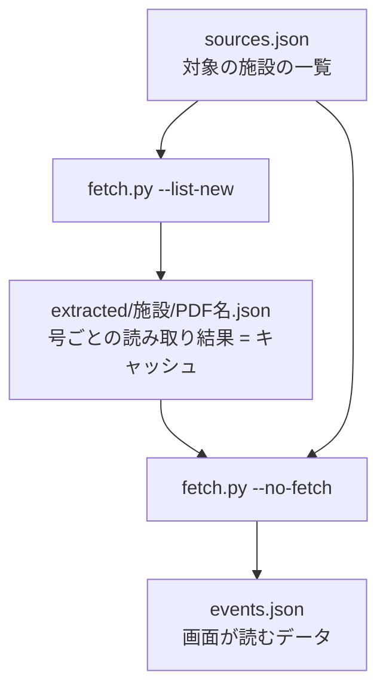

# 児童館のデータ

児童館カレンダーが使う3種類のデータの形式です。どう使われるかは [児童館カレンダーのしくみ](../explanation/jidoukan-pipeline.md) を見てください。

## `data/jidoukan/sources.json`

施設の配列です。並び順が画面の施設の色の順（6色を順に使う）になります。

| 項目 | 必須 | 内容 | 例 |
|---|---|---|---|
| `key` | ○ | 識別子。英小文字とアンダースコア。あとから変えない | `honan` |
| `name` | ○ | 画面に出す正式な名前 | `方南児童館` |
| `short` | | カレンダーに出す短い名前。省略すると `name` から「児童館」を除いたもの | `方南` |
| `page_url` | ○ | 区の施設ページ | `https://www.city.suginami.tokyo.jp/s076/3517.html` |
| `address` | | 住所 | `杉並区方南1-51-7` |
| `tel` | | 電話番号。申込カードに出る | `03-3323-6105` |
| `pdf_label_keyword` | | 読む PDF のリンク文字列に含まれる言葉。文字列か配列（どれかを含めば読む）。省略時は「おたより」 | `["ニュース"]` |

## `data/jidoukan/extracted/<key>/<PDF名>.json`（キャッシュ）

おたより1号ぶんの読み取り結果です。

| 項目 | 内容 |
|---|---|
| `pdf_url` | 元の PDF |
| `pdf_label` | リンク文字列 |
| `sha256` | PDF の中身から計算した値。これが同じなら読み直さない |
| `extracted_at` | 登録した日時（UTC） |
| `method` | `manual`（人が見て登録）／`claude-scheduled-session`（定期更新）／`claude-opus-5-5` など（API）／`skipped-past`（省略） |
| `skipped` | 省略した号だけに付く理由の文。この号は画面に出ない |
| `data` | 読み取った中身（下の表） |

### `data` の中身

`scrapers/jidoukan/extract.py` の `SCHEMA` が正本です。

| 項目 | 内容 |
|---|---|
| `year` / `month` | おたよりの対象年月 |
| `closed_days` | 休館日の配列。`{"date": "2026-11-03", "reason": "文化の日"}` |
| `events` | 行事の配列（下の表） |

### 行事（`events` の1件）

| 項目 | 内容 | 例 |
|---|---|---|
| `title` | 行事名 | `けん玉講習会` |
| `subtitle` | 事業名などの補足 | `杉並区児童館第1ブロック ほっとエッセンス事業` |
| `audience` | `kids`（小学生以上）／`baby`（乳幼児親子）／`all`（どなたでも） | `kids` |
| `regular` | 毎日・毎週の定例のプログラムなら `true` | `false` |
| `sessions` | 開催日時の配列。`{"date": "2026-11-19", "start": "15:45", "end": "16:45"}`。時刻は 24 時間表記、不明なら空文字 | |
| `place` | 場所 | `遊戯室` |
| `target` | 対象 | `1年生〜` |
| `capacity` | 定員や参加条件 | `先着25人` |
| `requires_application` | 申込制なら `true` | `true` |
| `application_start` / `application_end` | 申込の受付開始日・締切日（`YYYY-MM-DD`。なければ空文字） | `2026-11-05` |
| `application_method` | 申込方法 | `本人が児童館受付で` |
| `notes` | 補足の配列。原本の食い違いを判断したときは、その理由も書く | |

## `data/jidoukan/events.json`

画面が読むデータです。`fetch.py --no-fetch` がキャッシュ全体から作ります。手で直さないでください（直すならキャッシュを直して作り直す）。

| 項目 | 内容 |
|---|---|
| `generated_at` | 作った日時 |
| `centers` | `sources.json` の写し |
| `months` | 号ごとの `center`、`year`、`month`、`pdf_url`、`method`、`closed_days`。省略した号は入らない |
| `events` | 全施設の行事。上の行事の項目に、`id`（`<key>-<年月>-<番号>`）、`center`、`pdf_url` が加わる |
| `warnings` | 確かめたときの警告の一覧 |
