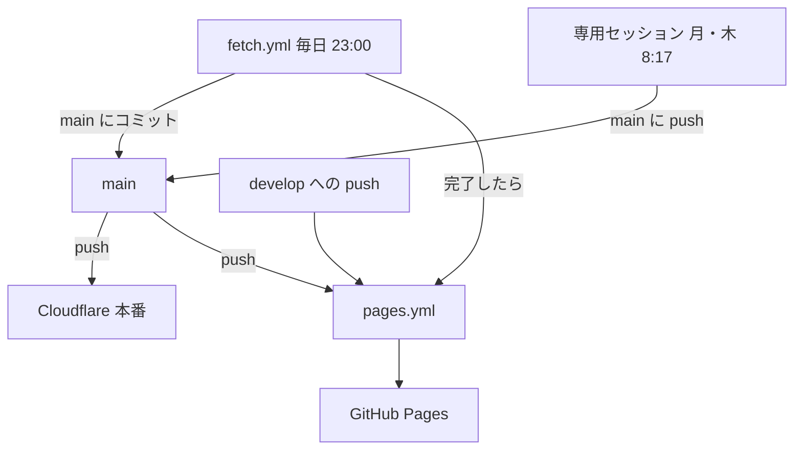

# 環境と自動処理

## 公開先

| 公開先 | 中身 | アドレス | 更新のきっかけ |
|---|---|---|---|
| 本番 | `main` | Cloudflare Workers の本番 URL | `main` への push（定期更新を含む） |
| プレビュー | PR のブランチ | PR に bot がコメントする Branch Preview URL | PR への push |
| 開発用 | `develop` のコード + `main` の `data/` + `docs/` | https://gghatano.github.io/suginami-matome/ | `develop`・`main` への push、データ更新ワークフローの完了、手動 |

- 開発者ドキュメントと `CLAUDE.md` は、`.assetsignore` で Cloudflare に出していない
- GitHub の設定で必要なもの
  - Settings → Pages → Source：**GitHub Actions**
  - Settings → Environments → github-pages → Deployment branches：**`main` と `develop` の両方**を許可
  - Settings → Rules：`develop` の削除を禁止（推奨）

## 自動処理

| 何を | いつ | どこで | 結果 |
|---|---|---|---|
| まとめサイトの記事を集める | 毎日 23:00 JST | GitHub Actions `fetch.yml` | `data/items.json` を `main` にコミット |
| 児童館のおたよりを読む | 毎週 月・木 8:17 JST | スケジュールしたタスク「児童館カレンダー更新（月・木）」→ 専用セッション「児童館カレンダー週次更新（専用）」 | `data/jidoukan/` を `main` に push |
| 児童館のおたよりを読む（API 版） | 手動のみ | GitHub Actions `jidoukan.yml`（`ANTHROPIC_API_KEY` が必要） | 同上 |
| GitHub Pages を公開 | 上の更新のあと、`develop`・`main` への push | GitHub Actions `pages.yml` | Pages が更新される |

GitHub Actions が自分で行った push では、ほかのワークフローは起動しません。そのため Pages は、push だけでなく「データ更新ワークフローの完了」もきっかけにしています。

## 権限（Claude のセッションからできること）

| 操作 | できるか | 備考 |
|---|---|---|
| ブランチへの push、PR の作成 | できる | |
| PR のマージ | できる | 人が頼んだときだけ |
| `main` への直接 push | できる | データの定期更新だけで使う |
| リモートブランチの削除 | **できない**（403 で拒否される） | GitHub の画面（Branches）で消す |
| github.io・Cloudflare のページを開く | できない（ネットワークの許可外） | 人がブラウザで確かめる |
| 区のサイトの取得 | できる | `www.city.suginami.tokyo.jp` は許可済み |
| GitHub の設定（Pages、Environments、Rules）の変更 | できない | 人が設定画面で行う |

## 困ったとき

| 症状 | よくある原因 | 対処 |
|---|---|---|
| GitHub Pages が古いまま | `develop` が無い／公開が失敗している | Actions の「Deploy to GitHub Pages」を見る。数秒で失敗していてログが無いなら、Environments で `develop`・`main` が許可されているか確かめる |
| Pages からドキュメントが消えた | `main` の `pages.yml` が古い | `develop` → `main` で最新の `pages.yml` を入れる |
| 児童館カレンダーが更新されない | 定期更新の push の拒否／区のページの構成の変化 | [定期更新を見る・直す](../howto/weekly-update.md) |
| 同じおたよりが毎回「未読」に出る | キャッシュに登録していない | `register.py`（または `--skip-past`）で登録 |
| マージしたのに変更の一部が入っていない | マージのあとに同じブランチへ push した | 最新の `develop` から作り直して別の PR にする |
| `develop` が消えた | `develop` → `main` のマージで「Delete branch」を押した | `main` から作り直す（`git push origin origin/main:refs/heads/develop`）。Rules で削除を禁止する |
