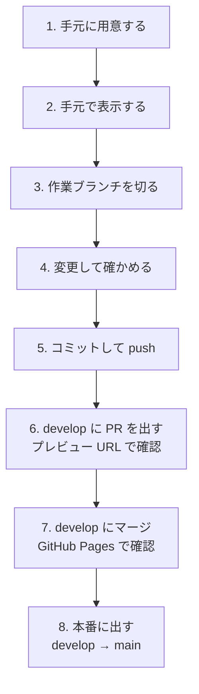
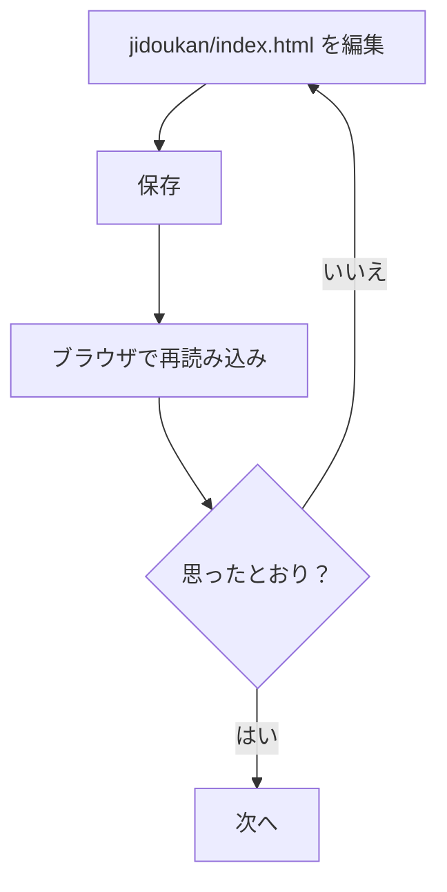

# はじめての変更

このチュートリアルでは、手元でサイトを表示し、文言を1つ変えて、本番に出すまでを一通り体験します。ここで覚えた流れは、ほかのどの作業でも同じです。

- **所要時間の目安**：30分
- **題材**：児童館カレンダーのページ上部の説明文を、少しだけ書き換える
- **言葉が分からないとき**：[用語集](../glossary.md)

## ゴール



## 1. 手元に用意する

必要なもの：Git、Python 3.12 以上、ブラウザ。

```bash
git clone https://github.com/gghatano/suginami-matome.git
cd suginami-matome
git checkout develop
```

`develop` は、本番に出す前の変更をためておくブランチです。作業はいつも `develop` から始めます。

## 2. 手元で表示する

```bash
python -m http.server 8000
```

ブラウザで次を開きます。

| アドレス | 見えるもの |
|---|---|
| http://localhost:8000/ | 杉並区イベントまとめ |
| http://localhost:8000/jidoukan/ | 児童館カレンダー |
| http://localhost:8000/docs/ | このドキュメント |

データ（`data/` の JSON）もリポジトリに入っているので、何もしなくても本番と同じように表示されます。止めるときは `Ctrl + C` です。

## 3. 作業ブランチを切る

```bash
git checkout -b try/first-change
```

ブランチ名は、作業の中身が分かる短い名前にします。Claude が作るブランチは `claude/...` という名前になっています。

## 4. 変更して確かめる

`jidoukan/index.html` を開き、`class="src"` の段落（ページ上部の説明文）を探します。文言を少し変えて保存し、ブラウザを再読み込みします。



画面を変えたときは、次も確かめる決まりです（詳しくは [画面を変える](../howto/change-screen.md)）。

- PC の幅とスマホの幅（ブラウザの開発者ツールで切り替えられる）
- ライトとダーク
- 変更したことで、下の要素の位置がずれていないか

## 5. コミットして push

```bash
git add jidoukan/index.html
git commit -m "docs: 児童館カレンダーの説明文を調整"
git push -u origin try/first-change
```

## 6. develop に PR を出す

GitHub のリポジトリのページに「Compare & pull request」が出るので押します。

- **base（向き先）を `develop` にする**（`main` ではありません）
- タイトルと説明に、何を・なぜ変えたかを書く

PR を出すと、Cloudflare の bot が数分で**プレビュー URL**をコメントします。そこで、本番と同じ環境で変更を確かめられます。

## 7. develop にマージして GitHub Pages で確かめる

問題なければ「Merge pull request」を押します。作業ブランチは、このときに「Delete branch」で消してかまいません。

`develop` にマージすると、GitHub Pages（https://gghatano.github.io/suginami-matome/ ）が数分で更新されます。ほかの人の変更と合わせた状態を、ここで確かめます。

## 8. 本番に出す

`develop` の変更をまとめて本番に出すときは、`develop` → `main` の PR を作ってマージします。手順と注意点（**このときは「Delete branch」を押さない**）は [本番に出す](../howto/release.md) にあります。

## おつかれさまでした

これで、変更が本番に届くまでの流れを一通り体験しました。次は、やりたい作業のハウツーを読んでください。

- [児童館を増やす](../howto/add-jidoukan.md)
- [画面を変える](../howto/change-screen.md)
- [取得元を増やす](../howto/add-event-source.md)

試しに作った変更が不要なら、PR を閉じる（Close）だけで大丈夫です。
